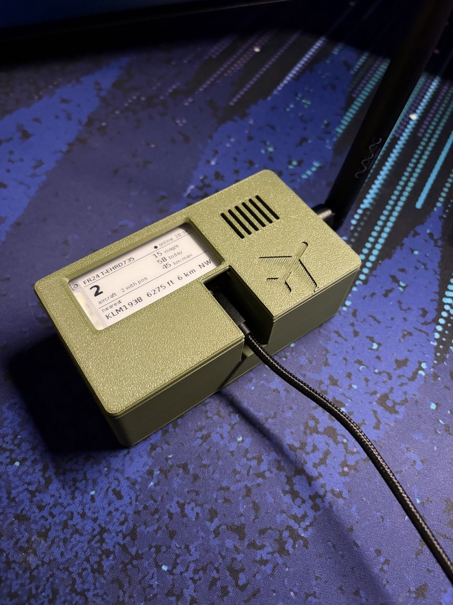
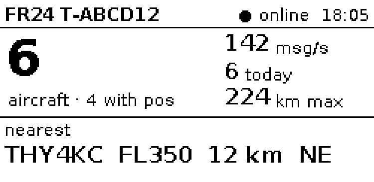

# fr24-eink-feeder

A Raspberry Pi Zero 2 W ADS-B receiver that feeds **Flightradar24** and shows live stats on a **Waveshare 2.13"
e-ink display**, built into a 3D-printed case. One script installs everything on plain **Raspberry Pi OS Lite
(64-bit)**. You don't need FR24's Pi24 image.




*The screen, rendered from sample data: aircraft tracked now, message rate, unique aircraft today, today's
furthest position, and the nearest aircraft.*

## What you get

- **readsb** decodes ADS-B from the RTL-SDR stick. It's built from source with RTL-SDR support.
- **fr24feed** reads readsb's Beast output on `127.0.0.1:30005` and feeds Flightradar24.
- **tar1090** is a live map at `http://<pi-address>/tar1090`.
- **adsb-eink** is the e-ink stats screen. It updates every minute and uses only local data.
- **The FR24 status page** is at `http://<pi-address>:8754`.

```
RTL-SDR ─▶ readsb ─┬─ Beast :30005 ─▶ fr24feed ─▶ Flightradar24
                   ├─ /run/readsb/*.json ─▶ adsb-eink ─▶ e-ink screen
                   └─ tar1090 map (:80)        fr24feed status (:8754)
```

## Hardware

| Part | Notes |
|---|---|
| Raspberry Pi Zero 2 W | Needs a **40-pin header**. The plain Zero 2 W ships without one: buy the *WH* version or solder one on (see [Troubleshooting](#the-screen-stays-blank)) |
| Waveshare **2.13" e-Paper HAT V4** | Black/white, 250×122. Check for the **V4** sticker on the back. Other revisions need a different driver file |
| RTL-SDR USB stick (RTL2832U) | Tested with a Nooelec NESDR SMArt v5 (R820T tuner) |
| 1090 MHz ADS-B antenna | Placement matters more than anything else: a window or the outdoors, as high as possible |
| Micro-USB OTG adapter or cable | The Zero's data port is micro-USB |
| 5 V / 2.5 A micro-USB power supply | The SDR stick adds its own draw on top of the Pi |
| microSD card, 8 GB or more | The install uses about 2.5 GB |
| 3D-printed case | See [Case](#case) |

## Case

The case was designed for this build. Print files and photos: **[ADS-B Flight Tracker w/ Pi Zero 2W, Nooelec & display on MakerWorld](https://makerworld.com/en/models/3540241-adsb-flight-tracker-w-pi-zero-2w-nooelec-display#profileId-4048770)**.

Take the SD card out before you open the case. A card left in the slot can snap.

## Software

Tested on 2026-11-04:

| Component | Version |
|---|---|
| Raspberry Pi OS Lite (64-bit) | Debian 13 **trixie**, kernel 6.18 |
| readsb (wiedehopf) | 3.16.21, built by `readsb-install.sh` |
| fr24feed | 1.0.57-1 (arm64, FR24's apt repo) |
| tar1090 | latest, from wiedehopf's installer |
| Waveshare e-Paper driver | `epd2in13_V4`, pinned to commit `d28b3c4` |
| Python | Pillow 11.1, gpiozero 2.0.1 + lgpio, spidev (all from apt) |

### Why not FR24's own decoder?

On trixie, fr24feed's default receiver (`dvbt`) tries to install a 2015 **32-bit** `dump1090-mutability` package.
It never finishes, and the feeder reports `Receiver: down`. The Linux DVB-TV driver also grabs the RTL-SDR stick
first. `install.sh` avoids both problems:
- it uses readsb as the decoder and points fr24feed at it with `beast-tcp`
- it writes `/etc/fr24feed.ini` *before* installing fr24feed
- it blacklists the DVB driver

## Before you start

You need two things in `config.env`:

| Variable | Required | What it is |
|---|---|---|
| `FR24_KEY` | for feeding | Your FR24 **sharing key**. If you already feed: flightradar24.com → your account → *Data sharing*, or the email FR24 sent at signup. **New to FR24?** Leave it empty: see step 6 below |
| `RX_LAT`, `RX_LON` | optional | The antenna's position in decimal degrees. In Google Maps, right-click the spot and click the coordinates to copy them. Use a decimal point, and negative numbers for south and west. Without them, readsb has no location, so the screen's *nearest* and *km max* stay empty |

`config.env` holds your sharing key. It is in `.gitignore`, and `install.sh` sets it to mode 600. Never commit it.

## Install

1. **Flash the card** with Raspberry Pi Imager: *Raspberry Pi OS Lite (64-bit)*. Under OS customisation set a
   hostname, a user and password, Wi-Fi, and **enable SSH**.
2. **Log in** over SSH. Optionally copy your key from your computer first:
   ```bash
   ssh-copy-id <user>@<pi-address>
   ```
3. **Get the code** on the Pi:
   ```bash
   sudo apt install -y git
   git clone https://github.com/Alpostros/fr24-eink-feeder.git
   cd fr24-eink-feeder
   ```
4. **Configure:**
   ```bash
   cp config.env.example config.env
   nano config.env
   ```
5. **Install.** It asks for your sudo password once, then runs unattended. Allow about 10 minutes on a Zero 2 W:
   readsb compiles from source. It logs to `/var/log/fr24-eink-install.log`.
   ```bash
   bash install.sh
   ```
6. **New FR24 feeder only:** run `sudo fr24feed --signup` and follow the prompts. Your sharing key arrives by
   email. Then run `bash install.sh` again: it keeps the new key and resets the receiver to readsb.
7. **Reboot once**, so the DVB driver blacklist and SPI apply from boot:
   ```bash
   sudo reboot
   ```
8. **Optional: key-only SSH.** Only do this after you've confirmed your SSH key logs in. The script refuses to run
   without an `authorized_keys` file.
   ```bash
   bash ssh-keyonly.sh
   ```

`install.sh` is safe to run again. It only installs readsb and fr24feed if they're missing, and it rewrites the
config from `config.env` each time.

## Check that it works

```bash
systemctl is-active readsb fr24feed adsb-eink
fr24feed-status
lsmod | grep -E 'rtl28|dvb'
```

- **`systemctl is-active`:** `active` three times.
- **`fr24feed-status`:** `FR24 Link: connected` and `Receiver: connected`. Right after a boot the link can read
  `unknown` for a minute or two.
- **`lsmod`:** prints nothing, meaning the DVB driver is blocked.
- **The map:** `http://<pi-address>/tar1090` shows aircraft.
- **The screen:** updates within a minute.

Reception is often near zero for the first minute while readsb's automatic gain settles, then it picks up.

## The screen

| Area | Shows |
|---|---|
| Header | FR24 radar ID, link status (● online / ○ status), clock |
| Big number | Aircraft heard in the last 60 s, plus how many have a position |
| Right column | Messages per second (last minute), unique aircraft today, furthest position today (km) |
| Bottom line | The nearest aircraft: callsign (or ICAO hex), altitude (`FLxxx` at or above 10,000 ft), distance, compass direction |

How it behaves:
- **Refresh:** a quick partial refresh every 60 s on the minute, and a full refresh every 30 minutes to clear
  ghosting. The panel goes into deep sleep when the service stops, following Waveshare's guidance for panel
  lifetime.
- **Daily counters** live in `/var/lib/adsb-eink/today.json`. They're saved every 10 minutes and reset at local
  midnight.
- **Data sources**, all local:
  - `/run/readsb/aircraft.json`, `stats.json` and `receiver.json`
  - `http://127.0.0.1:8754/monitor.json` (fr24feed)

**Customising:**
- **Upside down?** Run `sudo systemctl edit adsb-eink` and add:
  ```ini
  [Service]
  ExecStart=
  ExecStart=/usr/bin/python3 /opt/adsb-eink/adsb-eink.py --flip
  ```
- **Timing:** `INTERVAL`, `FULL_EVERY` and `SAVE_EVERY` at the top of `eink/adsb-eink.py`. Run `install.sh` again
  to deploy the change.
- **Preview without hardware:** `python3 eink/adsb-eink.py --png out.png --readsb-dir <folder with
  aircraft/stats/receiver.json>`. This never touches the panel. Set `ADSB_EINK_FONT_DIR` if DejaVu fonts aren't in
  `/usr/share/fonts/truetype/dejavu`.

## Troubleshooting

### `Receiver: down ... failed!`
fr24feed is on its own `dvbt` decoder. Check with `grep -v key /etc/fr24feed.ini`. Run `bash install.sh` again,
which rewrites it to `beast-tcp`. If apt complains about unmet dependencies, remove the half-installed package:
```bash
sudo dpkg --purge dump1090-mutability:armhf
```

### readsb can't open the stick (`usb_claim_interface error -6`)
The DVB-TV driver has the stick. `install.sh` blacklists it: reboot once.

### The screen stays blank
Run the panel test:
```bash
bash tools/panel-test.sh
```
It turns the screen black and prints timestamps. Look at the gap on the last `e-Paper busy` / `busy release` pair:
- **About 2,000 ms or more, and the screen turned black:** the hardware is fine. Check
  `journalctl -u adsb-eink`.
- **About 0 ms, and nothing happened:** the panel never answered. The driver can't detect that, so everything looks
  like it succeeded. Check, with the power off:
  1. **Header solder joints**, if you soldered the header yourself. Each should be a shiny cone covering the pad.
     Reflow anything dull, balled or bridged. The HAT uses physical pins 1, 2, 4 (power), 6, 9 (GND),
     11 (RST), 12 (PWR), 18 (BUSY), 19 (MOSI), 22 (DC), 23 (SCLK) and 24 (CE0).
  2. **Seating:** the HAT pushed fully down, pin 1 over pin 1.
  3. **The panel's flex strip** into the small latched connector on the HAT: fully inserted, latch closed.

### Only a few aircraft
- Give it a few minutes after a boot.
- Move the antenna: a window, higher up, away from the Pi and its power supply.
- Check that the antenna connector is tight.
- Set a fixed gain to compare: `sudo readsb-gain 49.6`, and back with `sudo readsb-gain auto`.

### No *nearest* / *km max*
No receiver location is set. Add `RX_LAT`/`RX_LON` to `config.env` and run `bash install.sh` again, or run
`sudo readsb-set-location <lat> <lon>`.

## Ports

| Port | Service | Notes |
|---|---|---|
| 80 | tar1090 map (lighttpd) | no authentication |
| 8754 | fr24feed status page | no authentication |
| 30001–30005, 30104 | readsb network ports | Beast output on 30005 feeds fr24feed |

Keep the Pi on a trusted network and don't port-forward these.

## Security notes

- Never commit `config.env`: it holds your FR24 sharing key.
- fr24feed stores the key in `/etc/fr24feed.ini` too. Its package makes that file world-writable; that's FR24's
  design.
- `ssh-keyonly.sh` writes `/etc/ssh/sshd_config.d/00-keyonly.conf`. The `00-` prefix matters: sshd keeps the
  first value it reads, and Raspberry Pi OS's `50-cloud-init.conf` may re-enable passwords otherwise. To undo it
  from a console: delete that file, then run `sudo systemctl reload ssh`.

## Files

```
install.sh              one-shot installer (asks for sudo once)
config.env.example      copy to config.env: FR24_KEY, RX_LAT, RX_LON
ssh-keyonly.sh          optional: disable password SSH
eink/adsb-eink.py       the e-ink stats screen
eink/adsb-eink.service  its systemd unit (runs as user adsb-eink, groups spi + gpio)
tools/panel-test.sh     hardware check for the e-ink panel
docs/screen-preview.png README image
```

What `install.sh` puts on the Pi:
- `/opt/adsb-eink/`: the screen script and the three Waveshare driver files
- `/etc/systemd/system/adsb-eink.service`
- `/etc/modprobe.d/blacklist-rtl-sdr.conf`
- `/etc/fr24feed.ini`
- readsb, tar1090 and fr24feed, through their own installers

## Credits

- [readsb](https://github.com/wiedehopf/readsb) and [tar1090](https://github.com/wiedehopf/tar1090) by
  wiedehopf, installed with his [adsb-scripts](https://github.com/wiedehopf/adsb-scripts)
- [Waveshare e-Paper](https://github.com/waveshareteam/e-Paper) driver
- fr24feed by Flightradar24

Each is downloaded at install time under its own license. This project is not affiliated with Flightradar24 or
Waveshare.

## License

[MIT](LICENSE)
